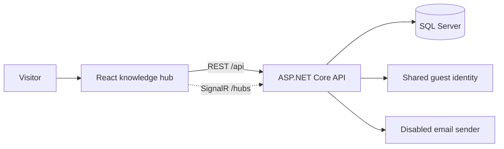

# Architecture

WorxForge separates domain contracts, application handlers, persistence,
and HTTP endpoints. The React app calls a typed API client; Vite proxies local
API and SignalR requests.

Guest mode supplies both `sub` and `NameIdentifier` claims for the synthetic user
seeded at startup. Existing ownership and foreign-key rules continue to work.
It supplies the ordinary User role, preserving restricted admin policies.
No browser token or external identity provider is required. When guest mode is
explicitly disabled, the configured Google/JWT flow is used instead.

Notifications are saved before SignalR delivery is queued. The email sender
completes without network access while SMTP integration is pending.
The seed contains only generic asset types, domains, use cases, and tool names.
Migrations define schema and lookup data; they do not contain user/asset exports.
